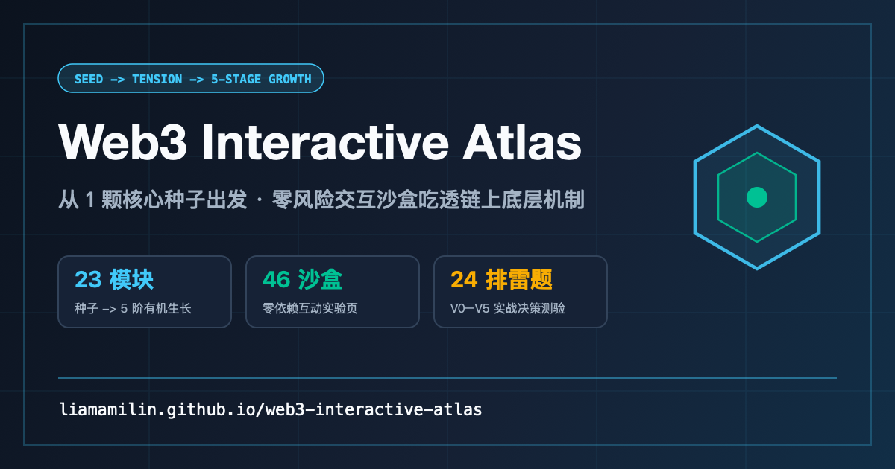

# Web3 Interactive Atlas

> **纯静态零依赖 · 在线交互图谱**：23 大模块 · 46 个互动实验页 · V0–V5 24 题综合排雷测验 · 术语速查 · 实战工具箱

一套按**「唯一核心种子 → 现实张力 → 逐阶有机生长」**组织的 Web3 全景交互沙盒图谱。打开 `index.html` 即可从第一颗种子一步步推演整个链上世界。

## 唯一种子与 5 阶有机生长脉络

- **🌱 唯一核心种子（起点闭环）**：没有银行与中心服务器，账本放哪、谁能记账、凭什么认同？先把「存储 / 提议 / 验证 / 认同」拆开重组，并用「初始状态 / 交易 / 记账 / 激励 / 治理」五维框架横向解剖 BTC / ETH / SOL / DOGE → `00-blockchain-blueprint`、`01-wallet-keys`、`09-consensus-ledger`
- **🔥 第 1 阶 · 拥堵竞价、托管边界与人性防线**：公共账本空间有限 + 私钥丢/被盗无客服兜底 → 逼出 `02-tx-gas-multichain`、`20-custody-multisig`、`03-security-traps`
- **🔥 第 2 阶 · 代码管钱与无许可金融引擎**：只会转币无法自动托管、换币、借贷与生息 → 先逼出关键桥梁 `22-smart-contracts-composability`（智能合约与链上乐高），再长出 `04-first-swap-amm`、`19-clmm-yield-splitting`、`05-stablecoins-peg`、`06-lending-liquidation`、`18-staking-restaking`、`07-perps-leverage`、`08-bonding-curves`
- **🔥 第 3 阶 · 繁荣反噬：性能极限、暗面博弈与隐私代价**：DeFi 挤爆主网 + 公开 Mempool 招来夹子 + 全透明账本扒光身份 → 逼出 `10-scaling-bridges`、`11-mev-dark-forest`、`21-zk-privacy`
- **🔥 第 4 阶 · 现实连接与资本排雷**：链上合约读不到现实数据 + 低门槛发币滋生高 FDV 抛压与庞氏补贴 → 逼出 `13-oracles-real-apps`、`12-tokenomics`、`14-onchain-forensics`
- **🔥 第 5 阶 · 破圈的最后三道墙**：助记词与 Gas 拦住大众 + 链下万亿资产进不来 + AI Agent 办不了银行卡 → 逼出 `15-account-abstraction`（含 EIP-7702）、`16-rwa-institutional`、`17-ai-agent-crypto`

## 配套实战能力
- **🌱 渐进生长首页（`index.html`）**：默认从种子层逐阶推演展开，不提前剧透高阶概念；支持一键切换「完整目录与路线视图」、关键词直达搜索、深浅模式与跨设备 JSON 进度备份。
- **🧭 V0–V5 综合排雷测验（`quiz.html`）**：24 道真实链上决策场景（含 V0 四职能、哈希链、激励安全预算与治理分叉），支持点亮 6 阶通关徽章与导出 1200×630 PNG 成绩单。
- **📖 术语速查（`glossary.html`）& 🧰 实战工具箱（`tools.html`）**：自动索引全站核心术语，并整理 12 款行业一手免费工具。

## 本地运行与自动部署
- 直接双击 `index.html` 即可运行；新增模块后执行 `python3 scripts/sync_catalog.py` 自动更新目录。
- 推送到 GitHub `main` 分支后，`.github/workflows/deploy.yml` 会自动部署至 GitHub Pages。
